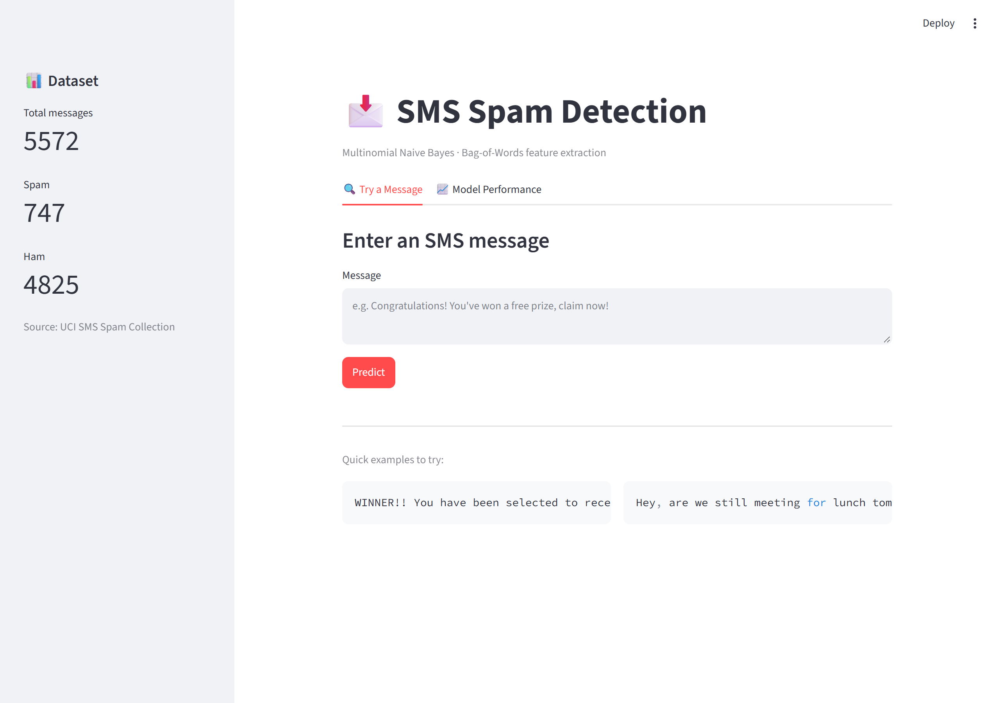
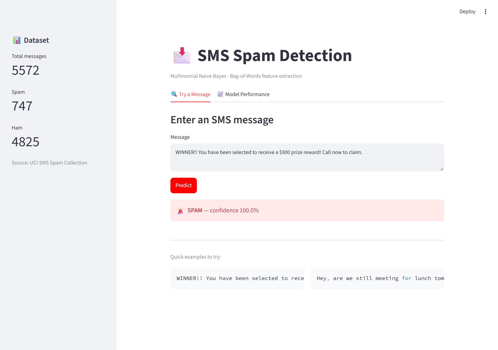
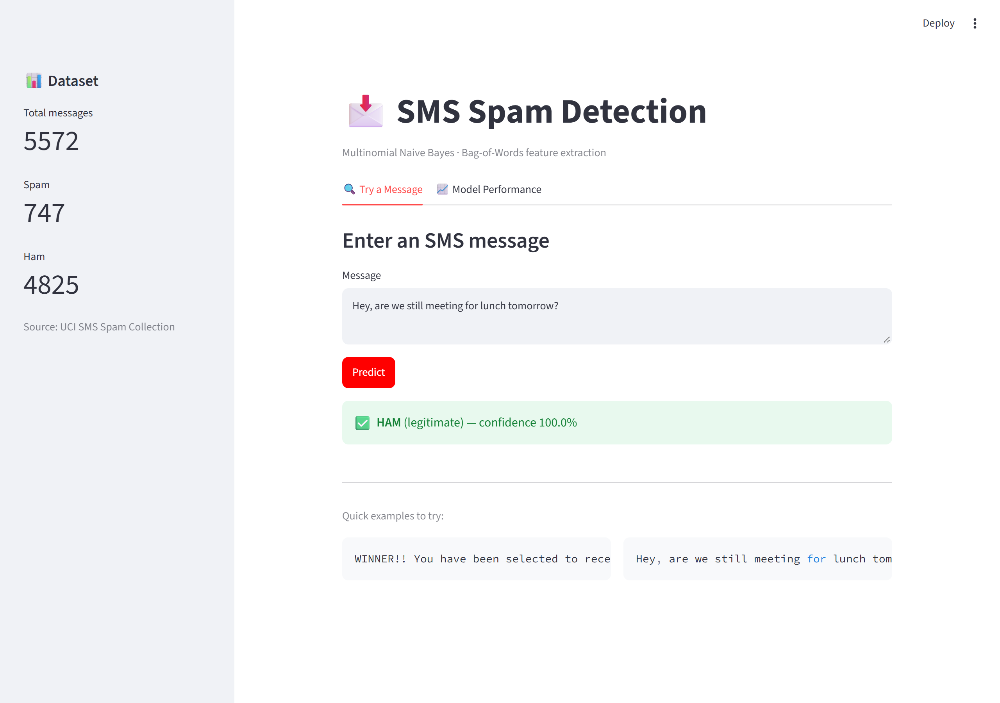
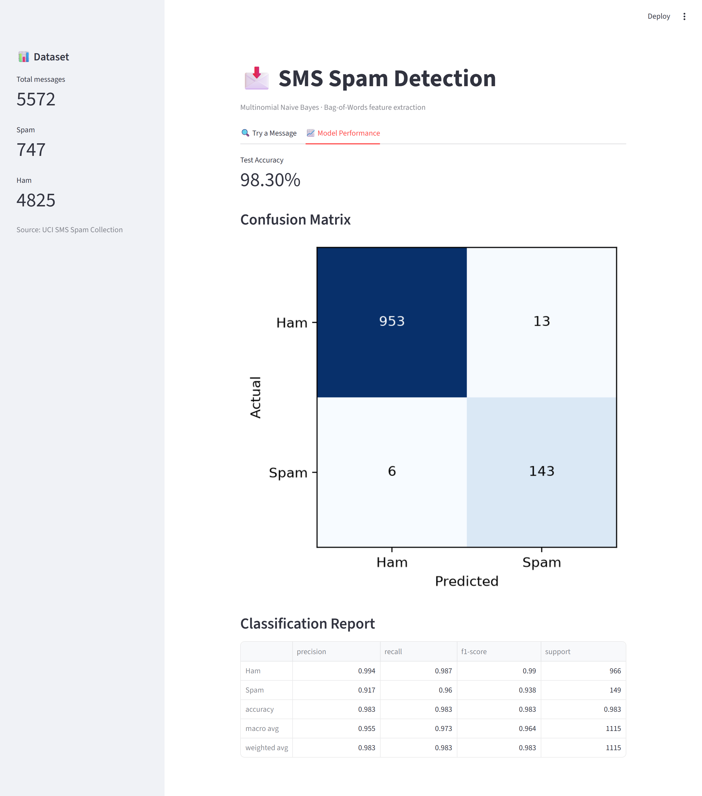

# SMS Spam Detection Using Multinomial Naive Bayes and Text Feature Extraction

A beginner-friendly machine learning mini-project that classifies SMS messages as **Spam** or **Ham** (legitimate). It has both a console version and a web GUI.

## Overview

| | |
|---|---|
| **Algorithm** | Multinomial Naive Bayes |
| **Dataset** | UCI SMS Spam Collection (5,572 messages: 4,825 ham, 747 spam) |
| **Feature Extraction** | Bag of Words (`CountVectorizer`, English stop words removed) |
| **Interfaces** | Console script **and** Streamlit web app |
| **Language / Libraries** | Python, pandas, scikit-learn, Streamlit, Matplotlib |
| **Test Accuracy** | **98.30%** |

## Project Structure

```
sms-spam-detector/
├── README.md                                 # This file
├── requirements.txt                          # Dependencies
├── main.py                                   # Console version: prints results to the terminal
├── app.py                                    # Web GUI version: interactive browser app (Streamlit)
├── sms.tsv.txt                               # Local copy of the dataset (for offline use)
└── screenshots/                              # Screenshots of the Streamlit web app
```

## Setup

1. Install Python 3.8 or newer.
2. Open this folder in VS Code (or any terminal).
3. Install the dependencies:

   ```bash
   pip install -r requirements.txt
   ```

## Run the Web App (recommended for demos)

```bash
streamlit run app.py
```

This opens a browser tab at `http://localhost:8501` with:

- **Try a Message tab:** type any SMS and get an instant Spam/Ham prediction with a confidence score, plus two example messages you can copy in.
- **Model Performance tab:** accuracy, a confusion matrix heatmap, and the full classification report.
- **Sidebar:** quick dataset stats (total messages, spam count, ham count).

## Streamlit Interface

**Home screen:** the "Try a Message" tab, with dataset stats in the sidebar.



**Spam detected:** a prize message flagged as SPAM with 100% confidence.



**Legitimate message:** a normal message classified as HAM with 100% confidence.



**Model Performance tab:** test accuracy, confusion matrix and classification report.



## Run the Console Version

```bash
python main.py
```

It prints the dataset info, accuracy, confusion matrix and classification report to the terminal, then asks you to type an SMS for a live prediction.

> **No internet?** Both scripts download the dataset from a public GitHub mirror when they start. To run offline, use the included `sms.tsv.txt`: replace the `url = "https://..."` line in `main.py` (and inside `load_data()` in `app.py`) with `url = "sms.tsv.txt"`.

## Results

Tested on 1,115 unseen messages (20% of the dataset):

| Class | Precision | Recall | F1-score | Support |
|---|---|---|---|---|
| Ham | 0.994 | 0.987 | 0.990 | 966 |
| Spam | 0.917 | 0.960 | 0.938 | 149 |
| **Accuracy** | | | **0.983** | 1,115 |

**Confusion matrix** (rows = actual, columns = predicted):

| | Predicted Ham | Predicted Spam |
|---|---|---|
| **Actual Ham** | 953 | 13 |
| **Actual Spam** | 6 | 143 |

## How It Works

1. **Dataset Loading:** reads the 5,572 labelled SMS messages into a pandas DataFrame (columns: `label`, `message`).
2. **Preprocessing:** maps labels to numbers (`ham = 0`, `spam = 1`) and lowercases the text.
3. **Text Feature Extraction:** `CountVectorizer` turns each message into a vector of word counts (Bag of Words), ignoring common English stop words.
4. **Train-Test Split:** 80% of the data trains the model and 20% is held out to evaluate it honestly (`random_state = 42`).
5. **Model Training:** `MultinomialNB` learns, from word frequencies, how much more likely each word is to appear in spam than in ham.
6. **Evaluation:** accuracy, confusion matrix and classification report (precision / recall / F1), shown in the terminal or as live charts in the web app.
7. **Custom Prediction:** type any SMS and get a live Spam/Ham prediction, with a confidence percentage in the web app.

The web app uses `@st.cache_data` and `@st.cache_resource`, so the dataset loads only once and the model trains only once per session. Clicking "Predict" repeatedly stays instant.

## Why Naive Bayes Works Well Here

Spam messages tend to reuse a small, predictable set of words ("free", "win", "claim", "prize"). Naive Bayes is built to exploit exactly that kind of word-frequency pattern. It naively assumes each word is independent of the others, but it still performs strongly on text classification in practice.

## Dataset Credit

T. A. Almeida, J. M. G. Hidalgo and A. Yamakami, *"Contributions to the Study of SMS Spam Filtering: New Collection and Results,"* ACM DocEng 2011. [UCI Machine Learning Repository](https://archive.ics.uci.edu/dataset/228/sms+spam+collection).


